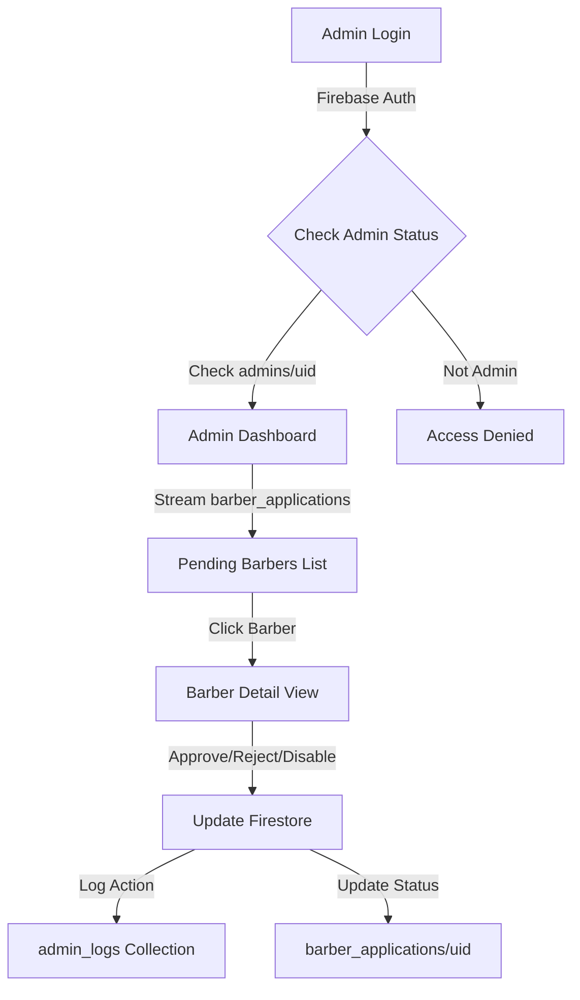

# Admin Web App - Best Cut

## Architecture Overview

The admin web app is a separate Next.js application that connects to the same Firebase project as the Flutter mobile app. It provides a secure interface for admins to review and manage barber applications.

### Tech Stack

- **Framework**: Next.js 14+ (App Router)
- **Language**: TypeScript
- **Styling**: Tailwind CSS
- **Firebase**: Auth, Firestore, Storage
- **Deployment**: Vercel

### Data Flow



## Project Structure

```
best-cut-admin/
├── .env.local                 # Firebase config (not committed)
├── .gitignore
├── next.config.js
├── package.json
├── tailwind.config.js
├── tsconfig.json
├── public/
│   └── favicon.ico
├── src/
│   ├── app/
│   │   ├── layout.tsx         # Root layout
│   │   ├── page.tsx            # Login page (redirects if authenticated)
│   │   ├── dashboard/
│   │   │   ├── page.tsx        # Dashboard (protected route)
│   │   │   └── barber/
│   │   │       └── [id]/
│   │   │           └── page.tsx # Barber detail view
│   │   └── api/
│   │       └── auth/
│   │           └── check/route.ts # Admin check endpoint
│   ├── components/
│   │   ├── AuthGuard.tsx       # Protected route wrapper
│   │   ├── LoginForm.tsx       # Login component
│   │   ├── Dashboard/
│   │   │   ├── StatsCards.tsx
│   │   │   ├── BarberList.tsx
│   │   │   └── BarberCard.tsx
│   │   ├── BarberDetail/
│   │   │   ├── BarberInfo.tsx
│   │   │   ├── DocumentsView.tsx
│   │   │   └── ActionButtons.tsx
│   │   └── LoadingSpinner.tsx
│   ├── lib/
│   │   ├── firebase/
│   │   │   ├── config.ts       # Firebase initialization
│   │   │   ├── auth.ts         # Auth helpers
│   │   │   └── firestore.ts    # Firestore helpers
│   │   ├── services/
│   │   │   ├── adminService.ts # Admin operations
│   │   │   └── barberService.ts # Barber data operations
│   │   └── types/
│   │       ├── barber.ts       # TypeScript types
│   │       └── admin.ts
│   └── hooks/
│       ├── useAuth.ts          # Auth state hook
│       ├── useAdminCheck.ts     # Admin verification hook
│       └── useBarbers.ts        # Barbers data hook
```

## Implementation Steps

### 1. Project Setup

**Files to create:**

- `package.json` - Next.js, Firebase SDK, Tailwind dependencies
- `next.config.js` - Next.js configuration
- `tailwind.config.js` - Tailwind setup
- `tsconfig.json` - TypeScript configuration
- `.env.local.example` - Environment variables template

**Dependencies:**

- `next`, `react`, `react-dom`
- `firebase` (v10+)
- `tailwindcss`, `autoprefixer`, `postcss`
- `@types/node`, `@types/react`

### 2. Firebase Configuration

**File: `src/lib/firebase/config.ts`**

- Initialize Firebase App with config from environment variables
- Export Firebase Auth, Firestore, and Storage instances
- Use same Firebase project as Flutter app

**Environment Variables (`.env.local`):**

```
NEXT_PUBLIC_FIREBASE_API_KEY=
NEXT_PUBLIC_FIREBASE_AUTH_DOMAIN=
NEXT_PUBLIC_FIREBASE_PROJECT_ID=
NEXT_PUBLIC_FIREBASE_STORAGE_BUCKET=
NEXT_PUBLIC_FIREBASE_MESSAGING_SENDER_ID=
NEXT_PUBLIC_FIREBASE_APP_ID=
```

### 3. Authentication & Security

**File: `src/lib/services/adminService.ts`**

- `checkAdminStatus(uid: string): Promise<boolean>` - Verify user is in `admins/{uid}` collection
- `getAdminDetails(uid: string): Promise<Admin | null>`

**File: `src/hooks/useAuth.ts`**

- React hook for Firebase Auth state
- Returns `{ user, loading, signIn, signOut }`

**File: `src/hooks/useAdminCheck.ts`**

- Hook that checks if current user is admin
- Returns `{ isAdmin, loading, error }`
- Calls `adminService.checkAdminStatus()` on mount and auth changes

**File: `src/components/AuthGuard.tsx`**

- Higher-order component that protects routes
- Redirects to login if not authenticated
- Redirects to access denied if not admin
- Shows loading state during checks

### 4. Data Structure

**New Firestore Collection: `barber_applications/{uid}`**

```typescript
{
  uid: string;                    // Same as users/{uid}
  name: string;
  email: string;
  phone: string;
  shopName?: string;
  status: 'pending' | 'approved' | 'rejected' | 'disabled';
  submittedAt: Timestamp;
  approvedAt?: Timestamp;
  approvedBy?: string;            // Admin UID
  rejectedAt?: Timestamp;
  rejectedBy?: string;
  rejectionReason?: string;
  disabledAt?: Timestamp;
  disabledBy?: string;
  disableReason?: string;
  documents: {
    profilePicture?: string;      // Firebase Storage URL
    idDocument?: string;
    shopPhotos?: string[];
    otherDocuments?: string[];
  };
  // Copy relevant fields from users/{uid}
  latitude?: number;
  longitude?: number;
  bio?: string;
}
```

**Update `admin_logs` collection:**

```typescript
{
  action: 'approve_barber' | 'reject_barber' | 'disable_barber';
  targetId: string;               // Barber UID
  adminId: string;                // Admin UID
  adminEmail: string;
  metadata: {
    reason?: string;
    previousStatus?: string;
  };
  timestamp: Timestamp;
}
```

### 5. Core Features Implementation

#### 5.1 Login Screen (`src/app/page.tsx`)

- Email + password form
- Firebase Auth sign-in
- After login, verify admin status
- Redirect to dashboard if admin, show access denied if not

#### 5.2 Dashboard (`src/app/dashboard/page.tsx`)

- Protected by `AuthGuard`
- Stats cards: Pending count, Approved count, Rejected count
- Real-time list of pending barbers using Firestore stream
- Search/filter functionality
- Click barber card → navigate to detail view

**File: `src/components/Dashboard/BarberList.tsx`**

- Stream `barber_applications` where `status == 'pending'`
- Display in card grid/list
- Show: Name, Email, Submitted Date, Status badge

#### 5.3 Barber Detail View (`src/app/dashboard/barber/[id]/page.tsx`)

- Fetch barber application data
- Display all profile information
- Show documents/images from Firebase Storage
- Action buttons: Approve, Reject, Disable

**File: `src/components/BarberDetail/DocumentsView.tsx`**

- Display profile picture
- Show ID document (if exists)
- Gallery of shop photos
- Download/view buttons for each document

**File: `src/components/BarberDetail/ActionButtons.tsx`**

- Approve button → Update status to 'approved', log action
- Reject button → Show modal for reason, update status, log action
- Disable button → Show modal for reason, update status, log action

### 6. Admin Service Implementation

**File: `src/lib/services/adminService.ts`**

```typescript
class AdminService {
  async approveBarber(barberId: string): Promise<void>
  async rejectBarber(barberId: string, reason: string): Promise<void>
  async disableBarber(barberId: string, reason: string): Promise<void>
  async logAction(action: string, targetId: string, metadata: object): Promise<void>
}
```

Each action:

1. Updates `barber_applications/{id}` status and timestamps
2. Optionally syncs status to `users/{id}` (if needed for mobile app)
3. Logs action to `admin_logs` collection

### 7. Real-time Updates

**File: `src/hooks/useBarbers.ts`**

- Custom hook using Firestore `onSnapshot`
- Streams `barber_applications` collection
- Filters by status (pending/approved/rejected)
- Returns reactive data that updates automatically

### 8. Firestore Security Rules Update

**Update `firestore.rules` in main project:**

```javascript
match /barber_applications/{applicationId} {
  // Admins can read all applications
  allow read: if isAdmin();
  
  // Barbers can only read their own application
  allow read: if isAuthenticated() && 
                request.auth.uid == applicationId;
  
  // Only admins can update application status
  allow update: if isAdmin() && 
                  request.resource.data.diff(resource.data).affectedKeys()
                    .hasAny(['status', 'approvedAt', 'approvedBy', 'rejectedAt', 'rejectedBy', 'rejectionReason', 'disabledAt', 'disabledBy', 'disableReason']);
  
  // Barbers can create their own application during signup
  allow create: if isAuthenticated() && 
                 request.auth.uid == applicationId;
}

match /admin_logs/{logId} {
  // Only admins can read logs
  allow read: if isAdmin();
  // Only admins can write logs
  allow write: if isAdmin();
}
```

### 9. UI/UX Design

- Clean, professional interface
- Dark mode support (optional)
- Responsive design (mobile-friendly)
- Loading states for all async operations
- Error handling with user-friendly messages
- Toast notifications for actions (success/error)

**Color Scheme:**

- Primary: Black/Dark Gray (matching Best Cut brand)
- Success: Green (approve actions)
- Warning: Orange (pending status)
- Error: Red (reject/disable actions)

### 10. Deployment Setup

**File: `vercel.json`**

- Configure environment variables
- Set up redirects if needed

**File: `README.md`**

- Setup instructions
- Environment variables guide
- Firebase configuration steps
- Deployment to Vercel guide

**Deployment Steps:**

1. Push code to GitHub
2. Connect repo to Vercel
3. Add environment variables in Vercel dashboard
4. Deploy

## Integration Points

### Sync with Mobile App

- When admin approves/rejects in web app, mobile app should reflect changes
- Mobile app reads from `users/{uid}` collection
- Consider syncing `barber_applications` status to `users/{uid}` status field
- Or mobile app can query `barber_applications` for status

### Firebase Storage Structure

```
barber_applications/
  {uid}/
    profile_picture.jpg
    id_document.pdf
    shop_photos/
      photo1.jpg
      photo2.jpg
    other_documents/
      document1.pdf
```

## Security Considerations

1. **Frontend Protection**: `AuthGuard` component blocks non-admins
2. **Backend Protection**: Firestore rules enforce admin-only access
3. **API Routes**: If needed, verify admin status server-side
4. **Environment Variables**: Never commit `.env.local`
5. **Firebase Config**: Use environment variables, not hardcoded values

## Testing Checklist

- [ ] Admin can log in with valid credentials
- [ ] Non-admin user is blocked from accessing dashboard
- [ ] Pending barbers list displays correctly
- [ ] Real-time updates work (open in two tabs, approve in one, see update in other)
- [ ] Approve action updates status and logs action
- [ ] Reject action requires reason and logs action
- [ ] Disable action requires reason and logs action
- [ ] Documents/images display correctly from Firebase Storage
- [ ] Firestore rules prevent unauthorized access

## Future Enhancements (Out of Scope)

- Email notifications to barbers on approval/rejection
- Bulk actions (approve multiple barbers)
- Advanced filtering and search
- Export reports
- Admin activity dashboard
- Multi-level admin roles